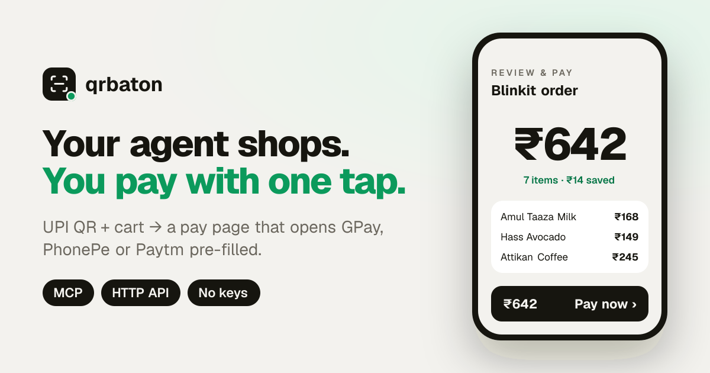
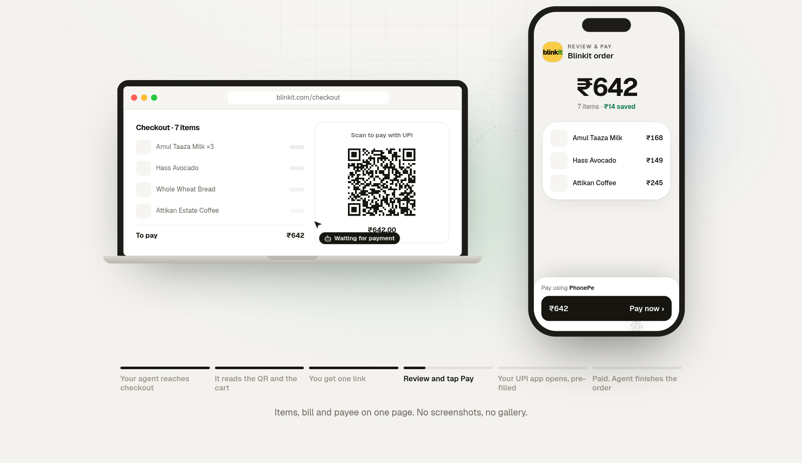
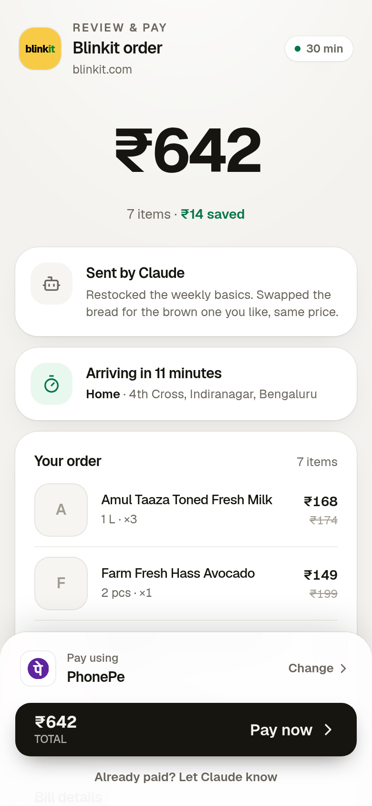
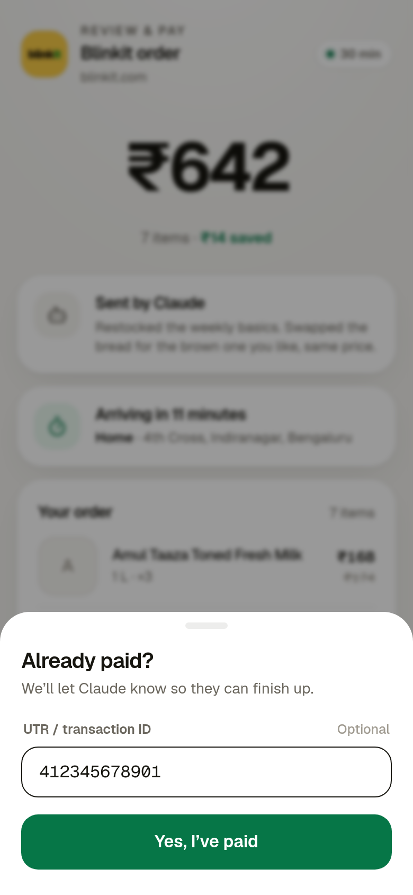
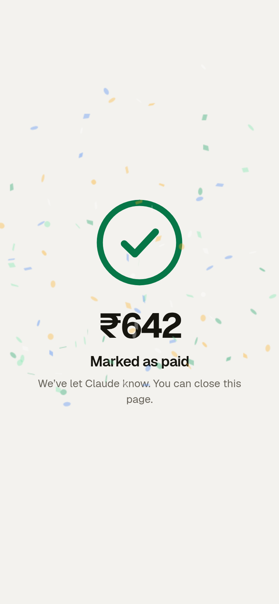

<p align="center">
  
</p>

<h1 align="center">qrbaton</h1>

<p align="center"><b>Your agent shops on a desktop. You pay with one tap.</b></p>

<p align="center">
  <a href="https://qrbaton.vercel.app">Website</a> ·
  <a href="https://qrbaton.vercel.app/demo">Live demo</a> ·
  <a href="#connect-your-agent">Connect your agent</a> ·
  <a href="https://qrbaton.vercel.app/llms.txt">llms.txt</a>
</p>

---

I send AI agents to shop for me. They work on a desktop, so at checkout they hit a **UPI QR** they can’t pay, and what follows is a screenshot relay: the agent sends the QR, I save it, open my UPI app, find “scan from gallery”, pick the screenshot, and check the amount.

**qrbaton** lets the agent pass the baton instead. It sends the QR and the cart, and I get one link: a clean review-and-pay page with a **Pay** button that opens GPay, PhonePe or Paytm with everything filled in. Once I’ve paid, the agent hears back and finishes the order.

<p align="center">
  
</p>

<p align="center">
  
  &nbsp;
  
  &nbsp;
  
</p>

## What it does

- **Reads any UPI QR** from screenshots, phone photos or crops. It’s decoded on the server, so the agent just sends the image.
- **Shows the whole cart:** items, prices, discounts, delivery slot and address, the shop’s site, and a note from the agent.
- **Opens your UPI app directly**, pre-filled, and remembers which app you used last.
- **Closes the loop:** live status, an **I’ve paid** button with an optional UTR, and signed webhooks.
- **Works on a laptop:** the pay page shows a fresh UPI QR to scan with your phone.
- **No keys, no accounts:** one HTTP call or MCP tool. Links expire on their own.
- **Never touches money:** it only builds the link. Your UPI app shows the real payee before you enter your PIN.

## Connect your agent

**Claude Code**

```bash
claude mcp add --transport http qrbaton https://qrbaton.vercel.app/mcp
```

**Any MCP client** (Claude Desktop, Cursor, Codex…)

```json
{ "mcpServers": { "qrbaton": { "type": "http", "url": "https://qrbaton.vercel.app/mcp" } } }
```

Tools: `create_pay_link`, `get_payment_status`, `set_payment_status`.

**Agent skill:** [`/SKILL.md`](https://qrbaton.vercel.app/SKILL.md) teaches the whole workflow, including “never send the screenshot, send the link”.

## HTTP API

Open to anyone, no key needed. The app serves its own agent docs: [`/llms.txt`](https://qrbaton.vercel.app/llms.txt), [`/openapi.json`](https://qrbaton.vercel.app/openapi.json), [`/SKILL.md`](https://qrbaton.vercel.app/SKILL.md).

```bash
BASE=https://qrbaton.vercel.app

# Payee as a QR upload, a base64 image ("qr"), a upi:// string ("upi"), or plain fields ("payee": {pa, pn, am})
curl -X POST $BASE/api/sessions -F qr=@checkout-qr.png \
  -F 'order={"merchant":"Blinkit","site":"https://blinkit.com","agent":"Claude","total":642,
    "items":[{"name":"Hass Avocado","qty":1,"price":149}],"charges":[{"label":"Item total","amount":642}]}'
# -> {"id","url","statusUrl","manageToken","expiresAt","payee"}

curl $BASE/api/sessions/{id}          # {"status":"pending|paid|failed|expired","paidBy"?,"utr"?}
curl -X PATCH $BASE/api/sessions/{id} -H "authorization: Bearer $MANAGE_TOKEN" -d '{"status":"paid"}'
```

- **Amount:** from `payee.am`, else `order.total`, else the sum of `order.items` (only when there are no `charges`, since charges are the full bill as displayed). If both the amount and the total are given they must match.
- **Webhooks:** add `"callbackUrl": "https://…"`. Every status change POSTs `{"event":"session.status",…}` signed as `x-qrbaton-signature: sha256=HMAC-SHA256(key = hex sha256(manageToken), raw body)`.
- **Payer claims:** `paidBy: "payer"` means the payer tapped *I’ve paid*. The creator can confirm it, or overrule it with `failed`. Otherwise terminal statuses are final.
- **Limits:** `CREATE_LIMIT_PER_HOUR` per IP (default 60). Payment stays open 30 minutes by default (set `expiresInMinutes`, up to 24 h). After that the page stays readable for another 24 h, with paying disabled.
- **Privacy:** pay pages are `noindex`, `no-store` and `Referrer-Policy: no-referrer`. Order details are labelled on the page as unverified, provided by the sender.

## Routes

| Route | |
|---|---|
| `/` | Landing page, plus a QR → pay link tool that works without an agent (decoded in the browser) |
| `/demo` | Sample pay page; Pay simulates the payment |
| `/p/{id}` | A pay session created through the API |
| `/?pa=…&pn=…&am=…` | A plain pay link, no backend; every param passes through to the deep links |
| `/mcp`, `/api/sessions` | MCP server and HTTP API |

## Run it yourself

Next.js (App Router) on Vercel, with Upstash Redis for sessions.

| Env var | |
|---|---|
| `KV_REST_API_URL` / `KV_REST_API_TOKEN` | Upstash Redis (Vercel Marketplace → Upstash; `UPSTASH_REDIS_REST_*` also work). Required in production. |
| `PUBLIC_URL` | Optional; origin for returned links and SEO (defaults to Vercel’s production URL) |
| `QRBATON_TOKEN` | Optional first-party secret: no rate limit, can update any session |
| `CREATE_LIMIT_PER_HOUR` | Optional; anonymous links per IP per hour (default 60) |

```bash
npm install
npm run dev              # without Redis, dev keeps sessions in memory
npm test && npm run build
```

### Offline helper: `bin/qrbaton-link`

Turns a QR image or `upi://` string into a plain `/?pa=…` link on `$QRBATON_URL`, without calling the API. Decoder: pyzbar if libzbar is installed, else OpenCV (`python3 -m venv .venv && .venv/bin/pip install opencv-python-headless pyzbar`).

```bash
bin/qrbaton-link qr.jpg            # -> pay link
bin/qrbaton-link --json qr.png     # {"link","upi","pa","pn","am",...}
```

## License

MIT. Geist fonts in `assets/fonts` are under the SIL Open Font License.
